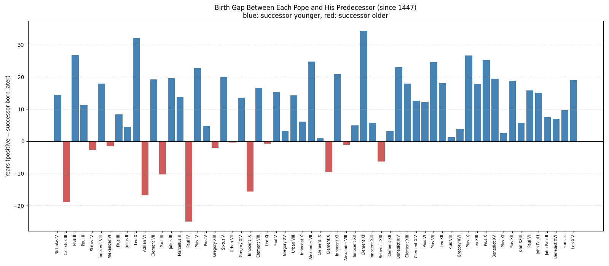
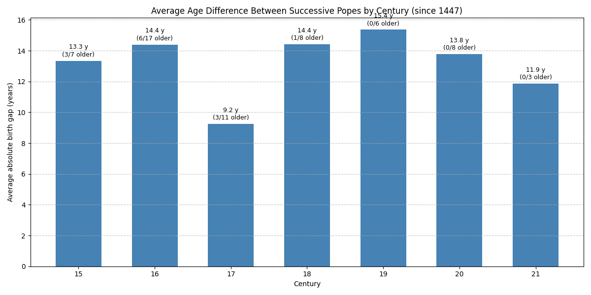

Note: This analysis covers the 60 transitions from Nicholas V (elected 1447) to Leo XIV (elected 2025), the period for which papal birth dates are documented rather than estimated. The "birth gap" is the time between the predecessor's birth and the successor's birth.

# Successors Much Younger Than Their Predecessors

| #   | Predecessor               | Born       | Successor                 | Born       | Birth gap          | Ages at election |
| --- | ------------------------- | ---------- | ------------------------- | ---------- | ------------------ | ---------------- |
| 1   | Innocent XII (1691-1700)  | 1615-03-13 | Clement XI (1700-1721)    | 1649-07-23 | 34.4 years later   | 76 → 51          |
| 2   | Julius II (1503-1513)     | 1443-12-05 | Leo X (1513-1521)         | 1475-12-11 | 32.0 years later   | 60 → 37          |
| 3   | Callixtus III (1455-1458) | 1378-12-31 | Pius II (1458-1464)       | 1405-10-18 | 26.8 years later   | 76 → 53          |
| 4   | Gregory XVI (1831-1846)   | 1765-09-18 | Pius IX (1846-1878)       | 1792-05-13 | 26.7 years later   | 65 → 54          |
| 5   | Leo XIII (1878-1903)      | 1810-03-02 | Pius X (1903-1914)        | 1835-06-02 | 25.3 years later   | 68 → 68          |
| 6   | Innocent X (1644-1655)    | 1574-05-06 | Alexander VII (1655-1667) | 1599-02-13 | 24.8 years later   | 70 → 56          |
| 7   | Pius VI (1775-1799)       | 1717-12-25 | Pius VII (1800-1823)      | 1742-08-14 | 24.6 years later   | 57 → 58          |
| 8   | Clement XII (1730-1740)   | 1652-04-07 | Benedict XIV (1740-1758)  | 1675-03-31 | 23.0 years later   | 78 → 65          |
| 9   | Paul IV (1555-1559)       | 1476-06-28 | Pius IV (1559-1565)       | 1499-03-31 | 22.8 years later   | 79 → 61          |
| 10  | Clement X (1670-1676)     | 1590-07-13 | Innocent XI (1676-1689)   | 1611-05-16 | 20.8 years later   | 80 → 65          |

Clement XI was born more than a generation after his predecessor: he was 51 when he succeeded the 76-year-old Innocent XII.

Leo XIII and Pius X were both 68 when elected, even though Pius X was 25 years younger. Leo XIII's 25-year pontificate made up the difference. Pius VI and Pius VII show the same effect.

# Successors Older Than Their Predecessors

| #   | Predecessor                | Born       | Successor                  | Born       | Birth gap           | Ages at election |
| --- | -------------------------- | ---------- | -------------------------- | ---------- | ------------------- | ---------------- |
| 1   | Marcellus II (1555-1555)   | 1501-05-06 | Paul IV (1555-1559)        | 1476-06-28 | 24.9 years earlier  | 54 → 79          |
| 2   | Nicholas V (1447-1455)     | 1397-11-13 | Callixtus III (1455-1458)  | 1378-12-31 | 18.9 years earlier  | 49 → 76          |
| 3   | Leo X (1513-1521)          | 1475-12-11 | Adrian VI (1522-1523)      | 1459-03-02 | 16.8 years earlier  | 37 → 63          |
| 4   | Gregory XIV (1590-1591)    | 1535-02-11 | Innocent IX (1591-1591)    | 1519-07-20 | 15.6 years earlier  | 56 → 72          |
| 5   | Clement VII (1523-1534)    | 1478-05-26 | Paul III (1534-1549)       | 1468-02-29 | 10.2 years earlier  | 46 → 67          |
| 6   | Clement IX (1667-1669)     | 1600-01-28 | Clement X (1670-1676)      | 1590-07-13 | 9.5 years earlier   | 67 → 80          |
| 7   | Innocent XIII (1721-1724)  | 1655-05-13 | Benedict XIII (1724-1730)  | 1649-02-02 | 6.3 years earlier   | 66 → 75          |
| 8   | Paul II (1464-1471)        | 1417-02-23 | Sixtus IV (1471-1484)      | 1414-07-21 | 2.6 years earlier   | 48 → 57          |
| 9   | Pius V (1566-1572)         | 1504-01-17 | Gregory XIII (1572-1585)   | 1502-01-07 | 2.0 years earlier   | 62 → 70          |
| 10  | Innocent VIII (1484-1492)  | 1432*      | Alexander VI (1492-1503)   | 1431-01-01 | ~1.5 years earlier* | 52 → 62          |

\* Only the year of Innocent VIII's birth is known, so this gap is approximate.

Only 13 of the 60 successors were older than the pope they replaced. Paul IV was born almost 25 years before Marcellus II. Marcellus II died 22 days into his pontificate, and the conclave then chose a 79-year-old.

Twice, a conclave answered the election of a young Medici pope with a much older one. Leo X (elected at 37) was followed by Adrian VI (63), and Clement VII (46) was followed by Paul III (67).

The last successor older than his predecessor was Benedict XIII, in 1724. **Since then, all 22 popes, from Clement XII (1730) to Leo XIV (2025), have each been younger than the pope before them.**

# Closest in Age

| #   | Predecessor                | Born       | Successor                  | Born       | Birth gap          | Ages at election |
| --- | -------------------------- | ---------- | -------------------------- | ---------- | ------------------ | ---------------- |
| 1   | Sixtus V (1585-1590)       | 1521-12-13 | Urban VII (1590-1590)      | 1521-08-04 | 0.4 years earlier  | 63 → 69          |
| 2   | Clement VIII (1592-1605)   | 1536-02-24 | Leo XI (1605-1605)         | 1535-06-02 | 0.7 years earlier  | 56 → 70          |
| 3   | Alexander VII (1655-1667)  | 1599-02-13 | Clement IX (1667-1669)     | 1600-01-28 | 1.0 years later    | 56 → 67          |
| 4   | Innocent XI (1676-1689)    | 1611-05-16 | Alexander VIII (1689-1691) | 1610-04-22 | 1.1 years earlier  | 65 → 79          |
| 5   | Leo XII (1823-1829)        | 1760-08-22 | Pius VIII (1829-1830)      | 1761-11-20 | 1.2 years later    | 63 → 67          |

Urban VII was born only about five months before his predecessor Sixtus V. He then had the shortest pontificate in history: 13 days.

# By Century

| Century | Transitions | Avg. absolute gap | Avg. gap    | Successor older |
| ------- | ----------- | ----------------- | ----------- | --------------- |
| 15th    | 7           | 13.3 years        | +6.8 years  | 3               |
| 16th    | 17          | 14.4 years        | +6.2 years  | 6               |
| 17th    | 11          | 9.2 years         | +7.2 years  | 3               |
| 18th    | 8           | 14.4 years        | +12.8 years | 1               |
| 19th    | 6           | 15.4 years        | +15.4 years | 0               |
| 20th    | 8           | 13.8 years        | +13.8 years | 0               |
| 21st    | 3           | 11.9 years        | +11.9 years | 0               |

On average, a new pope was born 9.5 years after his predecessor, and successive popes differ in age by 13.2 years.

