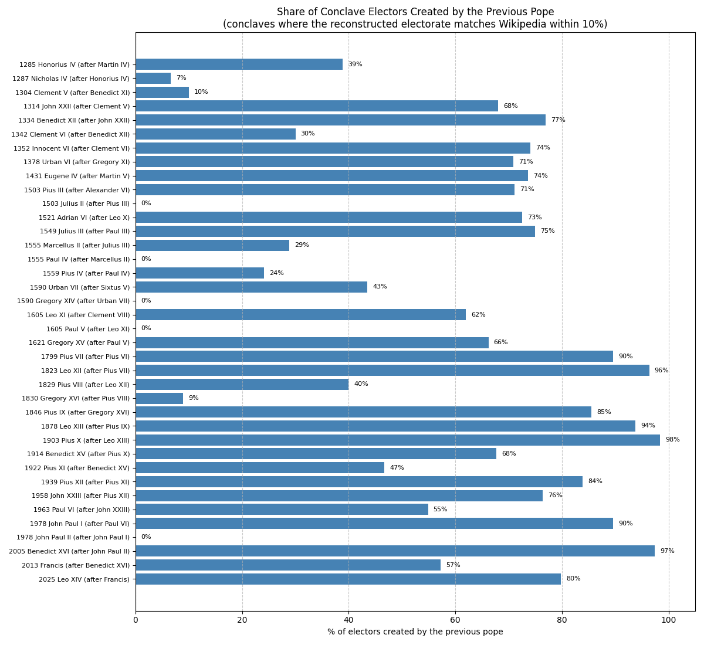
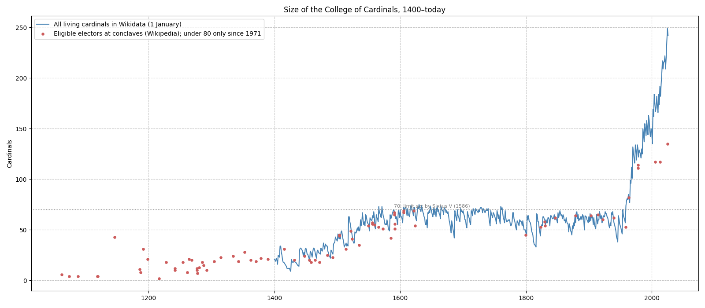

Note: The data combines two sources, matched cardinal by cardinal by [compare_cardinal_sources.py](compare_cardinal_sources.py) into [cardinals_combined.csv](cardinals_combined.csv):

- **Salvador Miranda, *The Cardinals of the Holy Roman Church*** (<https://cardinals.fiu.edu/>, ©1998–2023 Salvador Miranda), the standard reference for cardinals.
  - Its consistory lists, downloaded by [fetch_miranda.py](fetch_miranda.py) into [miranda_cardinals.csv](miranda_cardinals.csv), supply the **creation date, the creating pope and the date of death**.
  - Only these facts are used; none of the site's biographies are copied.
- **Wikidata**, downloaded by [fetch_cardinals.py](fetch_cardinals.py) into [cardinals.csv](cardinals.csv), supplies **birth dates and nationality**. It also covers the consistories held after Miranda's last update in 2023.

Some further rules:

- **Unknown death dates:** a cardinal with no recorded death date is assumed to have died within 60 years of creation; the longest recorded tenure is 60 years.
- **Antipopes:** cardinals they created are kept in the data but left out of conclave electorates.
- **Calendar:** Wikidata gives dates before 1582 in the Gregorian calendar, so they can differ by up to ten days from Julian dates.

# Comparing the Two Sources

Miranda's site lists **4,376 creations of cardinals**, from the 5th century to 2022. Wikidata has 3,484 cardinals. Matching them by name, creating pope, and dates of creation and death gives:

| Century of creation | Miranda | Also in Wikidata | Only in Miranda |
| ------------------- | ------- | ---------------- | --------------- |
| 5th–10th            | 492     | 25 (5%)          | 467             |
| 11th                | 341     | 61 (18%)         | 280             |
| 12th                | 486     | 156 (32%)        | 330             |
| 13th                | 148     | 125 (84%)        | 23              |
| 14th                | 237     | 210 (89%)        | 27              |
| 15th                | 236     | 202 (86%)        | 34              |
| 16th                | 410     | 388 (95%)        | 22              |
| 17th                | 358     | 345 (96%)        | 13              |
| 18th                | 344     | 335 (97%)        | 9               |
| 19th                | 456     | 453 (99%)        | 3               |
| 20th                | 585     | 580 (99%)        | 5               |
| 21st                | 283     | 283 (100%)       | 0               |

**Wikidata covers the modern cardinals almost completely but lacks most early ones**: about 1,100 cardinals created before 1300 exist only on Miranda's site. 321 cardinals exist only in Wikidata, most of them created after 2023 or with no date of creation at all.

Where both sources have a cardinal, they disagree on:

- **Creation date**, by more than a month, for 70 cardinals. For 8 of them Wikidata gives the date a cardinal created *in pectore* (in secret) was announced. Others are later promotions recorded as the creation. Luigi Oreglia, for example, was created by Pius IX in 1873, but Wikidata dates him to 1884, when Leo XIII made him a cardinal-bishop.
- **Date of death**, by more than a month, for 125 cardinals, mostly typos or placeholder dates in one of the sources.
- **Creating pope**, for 6 cardinals. Wikipedia's "Cardinals created by Pope X" categories occasionally misfile someone: János Simor, created by Pius IX in 1873, is filed under Leo XIII.

Every matched pair and its differences are listed in [cardinal_source_comparison.csv](cardinal_source_comparison.csv).

Coverage of the combined data:

| Century of creation | Cardinals | Exact creation date | Known birth | Known nationality |
| ------------------- | --------- | ------------------- | ----------- | ----------------- |
| 11th                | 358       | 0%                  | 16%         | 3%                |
| 12th                | 502       | 10%                 | 22%         | 5%                |
| 13th                | 153       | 61%                 | 73%         | 29%               |
| 14th                | 243       | 96%                 | 70%         | 53%               |
| 15th                | 241       | 98%                 | 84%         | 49%               |
| 16th                | 414       | 99%                 | 94%         | 46%               |
| 17th                | 363       | 99%                 | 96%         | 40%               |
| 18th                | 347       | 100%                | 97%         | 34%               |
| 19th                | 459       | 100%                | 99%         | 69%               |
| 20th                | 586       | 100%                | 100%        | 97%               |
| 21st                | 325       | 100%                | 100%        | 100%              |

Each pope is also linked to his own cardinal record (122 of them), so that his years as a cardinal end at his election.

# Who Chose the Electors?

Each conclave's electorate is reconstructed from the data: every cardinal created before the see fell vacant who was still alive and still a cardinal on that day. From 1971 on, cardinals aged 80 or over are left out, as the voting rules require.

The reconstruction matches Wikipedia's counts of eligible electors exactly in 1846, 1878, 1903, 1914, 1922, 1939, 1963, 2005 and 2013, and within three in every conclave since 1799. The table below includes the 38 conclaves, from 1285 on, where the two counts agree within 10%.

| Conclave          | Elected       | Electors | Created by the previous pope | Main creators |
| ----------------- | ------------- | -------- | ---------------------------- | ------------- |
| 1285              | Honorius IV   | 18       | 7 (39%)                      | Nicholas III 7, Martin IV 7 |
| 1287–1288         | Nicholas IV   | 15       | 1 (7%)                       | Martin IV 7, Nicholas III 6 |
| 1304–1305         | Clement V     | 19       | 2 (10%)                      | Boniface VIII 10, Celestine V 3 |
| 1314–1316         | John XXII     | 23       | 17 (68%)                     | Clement V 17, Boniface VIII 3 |
| 1334              | Benedict XII  | 24       | 20 (77%)                     | John XXII 20, Clement V 3 |
| 1342              | Clement VI    | 19       | 6 (30%)                      | John XXII 12, Benedict XII 6 |
| 1352              | Innocent VI   | 28       | 20 (74%)                     | Clement VI 20, John XXII 3 |
| 1378              | Urban VI      | 22       | 17 (71%)                     | Gregory XI 17, Innocent VI 4 |
| 1431              | Eugene IV     | 20       | 14 (74%)                     | Martin V 14, Gregory XI 2 |
| September 1503    | Pius III      | 45       | 32 (71%)                     | Alexander VI 32, Sixtus IV 6 |
| October 1503      | Julius II     | 44       | 0 (0%)                       | Alexander VI 32, Sixtus IV 6 |
| 1521–1522         | Adrian VI     | 49       | 37 (73%)                     | Leo X 37, Alexander VI 7 |
| 1549–1550         | Julius III    | 54       | 42 (75%)                     | Paul III 42, Leo X 7 |
| April 1555        | Marcellus II  | 57       | 17 (29%)                     | Paul III 35, Julius III 17 |
| May 1555          | Paul IV       | 56       | 0 (0%)                       | Paul III 34, Julius III 17 |
| 1559              | Pius IV       | 55       | 14 (24%)                     | Paul III 27, Paul IV 14 |
| September 1590    | Urban VII     | 67       | 30 (43%)                     | Sixtus V 30, Gregory XIII 22 |
| October 1590      | Gregory XIV   | 65       | 0 (0%)                       | Sixtus V 30, Gregory XIII 21 |
| March 1605        | Leo XI        | 69       | 44 (62%)                     | Clement VIII 44, Sixtus V 14 |
| May 1605          | Paul V        | 67       | 0 (0%)                       | Clement VIII 44, Sixtus V 14 |
| 1621              | Gregory XV    | 69       | 49 (66%)                     | Paul V 49, Clement VIII 17 |
| 1799–1800         | Pius VII      | 45       | 43 (90%)                     | Pius VI 43, Benedict XIV 2 |
| 1823              | Leo XII       | 53       | 53 (96%)                     | Pius VII 53, Pius VI 2 |
| 1829              | Pius VIII     | 58       | 24 (40%)                     | Pius VII 35, Leo XII 24 |
| 1830–1831         | Gregory XVI   | 54       | 5 (9%)                       | Pius VII 27, Leo XII 24 |
| 1846              | Pius IX       | 62       | 53 (85%)                     | Gregory XVI 53, Leo XII 7 |
| 1878              | Leo XIII      | 64       | 60 (94%)                     | Pius IX 60, Gregory XVI 4 |
| 1903              | Pius X        | 64       | 63 (98%)                     | Leo XIII 63, Pius IX 1 |
| 1914              | Benedict XV   | 65       | 44 (68%)                     | Pius X 44, Leo XIII 21 |
| 1922              | Pius XI       | 60       | 28 (47%)                     | Benedict XV 28, Pius X 25 |
| 1939              | Pius XII      | 62       | 52 (84%)                     | Pius XI 52, Benedict XV 8 |
| 1958              | John XXIII    | 53       | 42 (76%)                     | Pius XII 42, Pius XI 13 |
| 1963              | Paul VI       | 82       | 45 (55%)                     | John XXIII 45, Pius XII 29 |
| August 1978       | John Paul I   | 114      | 103 (90%)                    | Paul VI 103, John XXIII 8 |
| October 1978      | John Paul II  | 111      | 0 (0%)                       | Paul VI 101, John XXIII 8 |
| 2005              | Benedict XVI  | 117      | 114 (97%)                    | John Paul II 114, Paul VI 3 |
| 2013              | Francis       | 117      | 67 (57%)                     | Benedict XVI 67, John Paul II 50 |
| 2025              | Leo XIV       | 135      | 107 (80%)                    | Francis 107, Benedict XVI 22, John Paul II 5 |

The "Electors" column is Wikipedia's count of eligible electors; the percentages use the reconstructed electorate.

- **1903:** Leo XIII had outlived nearly every cardinal he inherited. Of the 64 electors, **63 were his own creations**. The exception was the Dean of the College, **Luigi Oreglia di Santo Stefano**, the last surviving cardinal created by Pius IX.
- **1823:** all but two of the electors had been created by Pius VII.
- **2005:** John Paul II had created **114 of the 117** eligible electors.
- **2013:** Benedict XVI's eight-year pontificate left the electorate split: **67 of his cardinals and 50 of John Paul II's**. They elected a John Paul II cardinal, Francis.
- **2025:** Francis had created **80%** of the electors.
- **0%:** popes who reigned only weeks created no cardinals, so their successor was chosen entirely by earlier popes' appointees. This happened after Pius III (1503), Marcellus II (1555), Urban VII (1590), Leo XI (1605) and John Paul I (1978).
- **Electing a predecessor's cardinal:** of 103 popes with a known date of cardinalate, 37 were created cardinal by their immediate predecessor. Since 1800 this is the norm: 12 of the 17 popes elected. The exceptions are Pius VIII, Gregory XVI, John Paul II, Benedict XVI and Francis.



# Size of the College



The College grew from about 20 cardinals in the 15th century to the 70 set as a maximum by Sixtus V in 1586, a limit that held until John XXIII exceeded it in 1958. It now has around 250 living cardinals. Since 1971, cardinals aged 80 or over can no longer vote, which is why the electors at recent conclaves (red) number about half of the College.

# Popes Who Created the Most Cardinals

| #   | Pope         | Cardinals created | Per year of pontificate |
| --- | ------------ | ----------------- | ----------------------- |
| 1   | John Paul II | 231               | 8.7                     |
| 2   | Francis      | 163               | 13.5                    |
| 3   | Leo XIII     | 147               | 5.8                     |
| 4   | Paul VI      | 144               | 9.5                     |
| 5   | Pius IX      | 123               | 3.9                     |
| 6   | Pius VII     | 100               | 4.3                     |
| 7   | Paschal II   | 99                | 5.4                     |
| 8   | Benedict XVI | 90                | 11.4                    |
| 9   | Innocent II  | 79                | 5.8                     |
| 10  | Pius XI      | 76                | 4.5                     |

With both sources combined, the totals match the published figures: John Paul II 231, Leo XIII 147, Pius IX 123, Benedict XVI 90 and Francis 163.

- **Paschal II** (1099–1118) created more cardinals than any other medieval pope. This only shows up with Miranda's data, as Wikidata has few cardinals from that time.
- **Francis** created cardinals faster than any other pope: 13.5 per year.

# Youngest Cardinals at Creation

| #   | Cardinal                          | Born       | Created    | Age  | Created by    |
| --- | --------------------------------- | ---------- | ---------- | ---- | ------------- |
| 1   | Afonso of Portugal                | 1509-05-03 | 1517-07-01 | 8.2  | Leo X         |
| 2   | Luis, Count of Chinchón           | 1727-07-25 | 1735-12-19 | 8.4  | Clement XII   |
| 3   | Ferdinand of Austria              | 1609-05-16 | 1619-07-29 | 10.2 | Paul V        |
| 4   | Niccolò Caetani                   | 1526-03-05 | 1536-12-22 | 10.8 | Paul III      |
| 5   | Roberto de' Nobili                | 1541-09-27 | 1553-12-22 | 12.2 | Julius III    |
| 6   | Giovanni de' Medici (later Leo X) | 1475-12-20 | 1489-03-09 | 13.2 | Innocent VIII |
| 7   | Ferdinando de' Medici             | 1549-08-09 | 1563-01-06 | 13.4 | Pius IV       |
| 8   | Alessandro Farnese                | 1520-10-27 | 1534-12-18 | 14.1 | Paul III      |
| 9   | Giulio della Rovere               | 1533-04-15 | 1547-07-27 | 14.3 | Paul III      |
| 10  | Ippolito d'Este                   | 1479-03-29 | 1493-09-20 | 14.5 | Alexander VI  |

The youngest cardinals were royal princes and the sons and grandsons of the powerful. **Paul III** appears three times: Alessandro Farnese was his grandson, and Niccolò Caetani came from the family of Paul III's mother. Giovanni de' Medici became pope as Leo X, and Ferdinando de' Medici later gave up the red hat to become Grand Duke of Tuscany.

# Oldest Cardinals at Creation

| #   | Cardinal                          | Born       | Created    | Age  | Created by   |
| --- | --------------------------------- | ---------- | ---------- | ---- | ------------ |
| 1   | Angelo Acerbi                     | 1925-09-23 | 2024-12-07 | 99.2 | Francis      |
| 2   | Loris Francesco Capovilla         | 1915-10-14 | 2014-02-22 | 98.4 | Francis      |
| 3   | Luis Pascual Dri                  | 1927-04-17 | 2023-09-30 | 96.5 | Francis      |
| 4   | José de Jesús Pimiento Rodríguez  | 1919-02-18 | 2015-02-14 | 96.0 | Francis      |
| 5   | Domenico Bartolucci               | 1917-05-07 | 2010-11-20 | 93.5 | Benedict XVI |
| 6   | Jean-Baptiste de Belloy           | 1709-10-09 | 1803-01-17 | 93.3 | Pius VII     |

Recent popes have often honoured elderly priests with the red hat, too old to vote in a conclave. Four of the six oldest new cardinals were created by Francis. Loris Capovilla had been the secretary of John XXIII.

# Longest-Serving Cardinals

Only cardinals with exact dates of creation and death are ranked, and those who became pope are left out.

| #   | Cardinal              | Created    | Until      | Years |
| --- | --------------------- | ---------- | ---------- | ----- |
| 1   | Henry Benedict Stuart | 1747-07-03 | 1807-07-13 | 60.0  |
| 2   | Alessandro Albani     | 1721-07-16 | 1779-12-11 | 58.4  |
| 3   | Gian Francesco Albani | 1747-04-10 | 1803-09-15 | 56.4  |
| 4   | Francesco Barberini   | 1623-10-02 | 1679-12-10 | 56.2  |
| 5   | Alderano Cibo         | 1645-03-06 | 1700-07-22 | 55.4  |
| 6   | Alessandro Farnese    | 1534-12-18 | 1589-03-02 | 54.2  |

**Henry Benedict Stuart**, the last Stuart claimant to the British throne, was a cardinal for 60 years. Most of the others were made cardinals as young men from papal families: Alessandro Albani, a nephew of Clement XI, and his great-nephew Gian Francesco Albani; Francesco Barberini, created by his uncle Urban VIII; and Alessandro Farnese, created by his grandfather Paul III.

# Nationality

Nationality is recorded for almost every cardinal created since 1900, but for only 33–68% of earlier ones, too few for reliable shares. Among cardinals created in the 20th century, **36%** were Italian; in the 21st century, **22%**.

# Rerunning

```bash
python "Cardinal Statistics/fetch_cardinals.py"          # Wikidata and Wikipedia categories -> cardinals.csv
python "Cardinal Statistics/fetch_miranda.py"            # Miranda's consistory lists -> miranda_cardinals.csv
python "Cardinal Statistics/compare_cardinal_sources.py" # match both, report differences -> cardinals_combined.csv
python "Cardinal Statistics/cardinals.py"                # tables and charts
```
