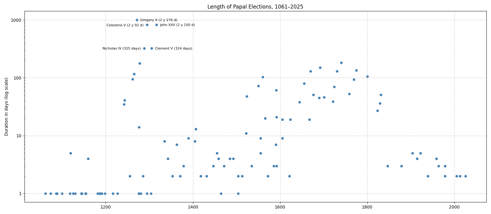
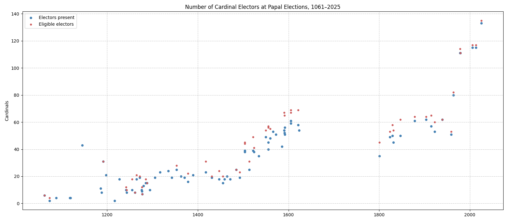

Note: Data is scraped from Wikipedia's [List of papal conclaves](https://en.wikipedia.org/wiki/List_of_papal_conclaves) and from the infobox of each election's article, by [scrape_conclaves.py](scrape_conclaves.py); the result is in [conclaves.csv](conclaves.csv).

- **Scope:** 112 papal elections from 1061 to 2025. Elections of antipopes are excluded.
- **Duration** counts both the first and the last day, as Wikipedia does: a conclave from 12 to 13 March lasts 2 days.
- **Coverage gaps:** the number of electors is known for 81 elections, and the number of ballots for only 45. Most 17th- and 18th-century conclaves have no elector count on Wikipedia.

# Overview

- Popes elected since 1061 have spent a combined **16 years** in elections.
- **28 elections** were decided in a single day, almost all of them before 1300.
- **26 elections** took place outside Rome. The last was the 1799–1800 conclave in Venice, held there because French troops occupied Rome. The last outside Italy was at the Council of Constance in 1417.
- The 2025 conclave had **133 electors**, the most in history. The 1061 election had 6.

# Longest Elections

| #   | Election                 | Elected       | Duration           | Electors | Ballots |
| --- | ------------------------ | ------------- | ------------------ | -------- | ------- |
| 1   | 1268–1271 (Viterbo)      | Gregory X     | 2 years 276 days   | 19       | 137     |
| 2   | 1314–1316 (Carpentras, Lyon) | John XXII | 2 years 100 days   | 23       | ?       |
| 3   | 1292–1294 (Rome, Perugia) | Celestine V   | 2 years 92 days    | 10       | ?       |
| 4   | 1287–1288                | Nicholas IV   | 325 days           | 15       | ?       |
| 5   | 1304–1305 (Perugia)      | Clement V     | 324 days           | 19       | ?       |
| 6   | 1740                     | Benedict XIV  | 182 days           | ?        | ?       |
| 7   | 1277 (Viterbo)           | Nicholas III  | 178 days           | 7        | ?       |
| 8   | 1691                     | Innocent XII  | 151 days           | ?        | ?       |
| 9   | 1774–1775                | Pius VI       | 134 days           | ?        | ?       |
| 10  | 1669–1670                | Clement X     | 130 days           | ?        | ?       |
| 11  | 1730                     | Clement XII   | 130 days           | ?        | ?       |
| 12  | 1264–1265 (Perugia)      | Clement IV    | 116 days           | 18       | ?       |

The longest elections all fall between 1264 and 1316. That period produced the conclave itself: after the cardinals at Viterbo took almost three years and 137 ballots to elect Gregory X, he issued *Ubi periculum* (1274), which required cardinals to be locked in until they chose a pope.

A second wave of long conclaves came in the 17th and 18th centuries. Catholic monarchies fought over the choice, and the cardinals split into rival factions. The 18th century has the highest median of any century: 82 days.



# Most Ballots

| #   | Election  | Elected       | Ballots | Duration         |
| --- | --------- | ------------- | ------- | ---------------- |
| 1   | 1268–1271 | Gregory X     | 137     | 2 years 276 days |
| 2   | 1261      | Urban IV      | 80      | 95 days          |
| 3   | 1721      | Innocent XIII | 75      | 39 days          |
| 4   | 1549–1550 | Julius III    | 61      | 72 days          |
| 5   | 1523      | Clement VII   | 42      | 48 days          |
| 6   | 1592      | Clement VIII  | 20      | 21 days          |
| 7   | 1830–1831 | Gregory XVI   | 14      | 51 days          |
| 8   | 1922      | Pius XI       | 14      | 5 days           |
| 9   | 1521–1522 | Adrian VI     | 12      | 11 days          |
| 10  | 1958      | John XXIII    | 11      | 4 days           |

Ballot counts are known for fewer than half of all elections, so this list probably misses some long ones.

# By Century

| Century | Elections | Median duration | Longest                      | Avg. electors |
| ------- | --------- | --------------- | ---------------------------- | ------------- |
| 11th    | 5         | 1 day           | 1 day (Alexander II)         | 4             |
| 12th    | 16        | 1 day           | 5 days (Callixtus II)        | 17            |
| 13th    | 17        | 14 days         | 2 y 276 d (Gregory X)        | 11            |
| 14th    | 10        | 5 days          | 2 y 100 d (John XXII)        | 21            |
| 15th    | 11        | 4 days          | 13 days (Gregory XII)        | 19            |
| 16th    | 17        | 7 days          | 103 days (Pius IV)           | 44            |
| 17th    | 11        | 38 days         | 151 days (Innocent XII)      | 58            |
| 18th    | 8         | 82 days         | 182 days (Benedict XIV)      | ?             |
| 19th    | 6         | 31 days         | 105 days (Pius VII)          | 48            |
| 20th    | 8         | 3 days          | 5 days (Pius X)              | 73            |
| 21st    | 3         | 2 days          | 2 days (Benedict XVI)        | 121           |

Modern conclaves are fast. Since 1831, the 14 conclaves have had a median of 3 days, and none in the 20th or 21st century lasted more than 5 days. The last long conclave was the 1830–1831 election of Gregory XVI, at 51 days.

# Electors



The electorate grew from the 6 cardinal-bishops of 1061 to about 20 cardinals in the late Middle Ages, and about 60 by 1600. It reached 133 in 2025.

Before modern travel, many eligible cardinals never arrived. In the April 1555 conclave, 17 of the 57 cardinals were absent; in both 1590 conclaves, 13 were missing.

# Locations

| City      | Elections | Years                                  |
| --------- | --------- | -------------------------------------- |
| Rome      | 86        |                                        |
| Viterbo   | 5         | 1261, 1271, 1276, 1277, 1280           |
| Avignon   | 5         | 1334, 1342, 1352, 1362, 1370           |
| Perugia   | 4         | 1216, 1265, 1285, 1305                 |
| Naples    | 2         | 1254, 1294                             |
| Terracina | 1         | 1088                                   |
| Cluny     | 1         | 1119                                   |
| Verona    | 1         | 1185                                   |
| Ferrara   | 1         | 1187                                   |
| Pisa      | 1         | 1187                                   |
| Anagni    | 1         | 1243                                   |
| Arezzo    | 1         | 1276                                   |
| Lyon      | 1         | 1316                                   |
| Constance | 1         | 1417                                   |
| Venice    | 1         | 1800                                   |

The 13th century was the age of wandering elections: popes often died away from Rome, in Viterbo, Perugia or Naples, and the cardinals elected the successor where they were.

# Rerunning

```bash
python "Conclave Statistics/scrape_conclaves.py"   # refresh conclaves.csv from Wikipedia
python "Conclave Statistics/conclaves.py"          # recompute the tables and charts
```
