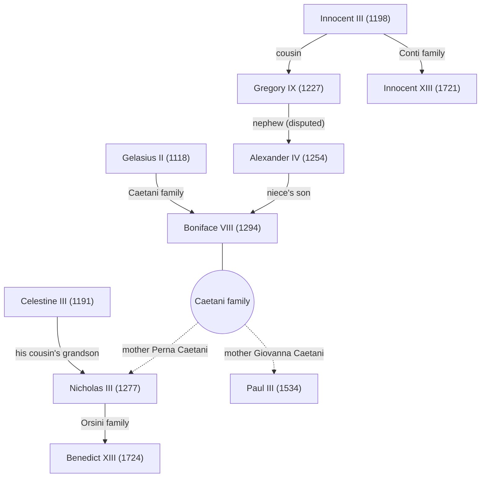
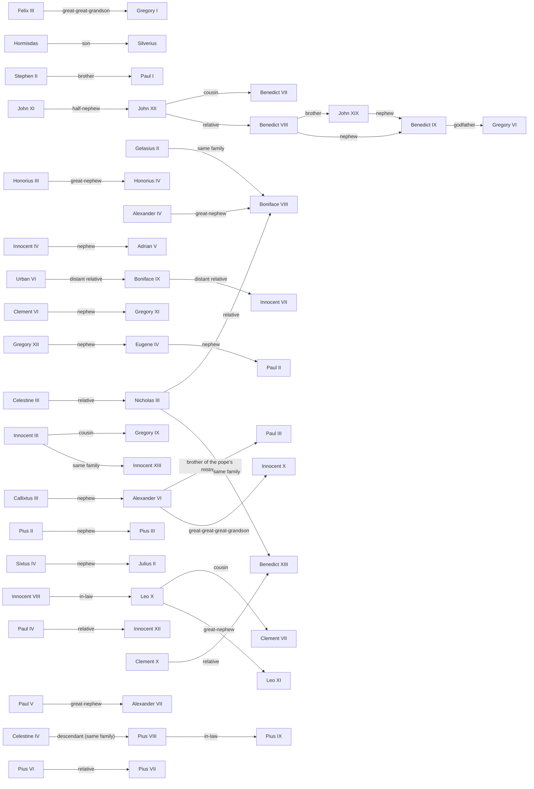

Note: Relationships come from Wikipedia: each pope's biography, the [List of cardinal-nephews](https://en.wikipedia.org/wiki/List_of_cardinal-nephews), the [List of popes](https://en.wikipedia.org/wiki/List_of_popes), and the articles on the Caetani, Conti di Segni, Orsini, Savelli, Borgia and Counts of Tusculum families. Several of these rely on George L. Williams, *Papal Genealogy: The Families and Descendants of the Popes* (2004).

Each tie is graded:

- **documented:** stated without reservation.
- **probable:** stated, but with uncertainty about the exact link.
- **disputed:** contested by historians.
- **speculative:** a guess based on names or circumstances.
- **legendary:** a later invention.

The full dataset is in [papal_family_ties.csv](papal_family_ties.csv).

# Overview

- **56 of 265 popes (21%)** had a documented or probable family tie to another pope.
- **38 ties** are documented or probable, 5 are disputed, and 5 more are speculative or legendary.
- **20 popes were made cardinals by a papal relative**: 15 of these ties are documented or probable, and 5 are disputed.
- Six popes were related to their **immediate predecessor**:
  - Stephen II → Paul I (brothers)
  - Benedict VIII → John XIX (brothers)
  - John XIX → Benedict IX (nephew)
  - Urban VI → Boniface IX (distant relative)
  - Boniface IX → Innocent VII (distant relative)
  - Pius VI → Pius VII (relative)

# Papal Dynasties

| Family                         | Popes                                                                              | Period     |
| ------------------------------ | ---------------------------------------------------------------------------------- | ---------- |
| Theophylacti / Counts of Tusculum | John XI, John XII, Benedict VII, Benedict VIII, John XIX, Benedict IX           | 931–1048   |
| Orsini                         | Stephen II and Paul I (by tradition), Celestine III, Nicholas III, Benedict XIII  | 752–1730   |
| Conti di Segni                 | Innocent III, Gregory IX, Alexander IV, Innocent XIII                             | 1198–1724  |
| Caetani                        | Gelasius II, Boniface VIII                                                         | 1118–1303  |
| Savelli                        | Honorius III, Honorius IV                                                          | 1216–1287  |
| Fieschi                        | Innocent IV, Adrian V                                                              | 1243–1276  |
| Roger de Beaufort              | Clement VI, Gregory XI                                                             | 1342–1378  |
| Correr / Condulmer / Barbo     | Gregory XII, Eugene IV, Paul II                                                    | 1406–1471  |
| Borgia                         | Callixtus III, Alexander VI (and their descendant Innocent X)                      | 1455–1655  |
| Piccolomini                    | Pius II, Pius III                                                                  | 1458–1503  |
| della Rovere                   | Sixtus IV, Julius II                                                               | 1471–1513  |
| Medici                         | Leo X, Clement VII, Leo XI                                                         | 1513–1605  |

- **Counts of Tusculum:** for most of the period 1012–1045, the papacy passed between two brothers, Benedict VIII and John XIX, and then to their nephew, Benedict IX.
- **Orsini:** produced popes across almost a thousand years, if the traditional claim to Stephen II and Paul I is accepted.
- **Medici:** Pius IV (1559–1565) was born Giovanni Angelo Medici, but his family was from Milan and unrelated to the Florentine Medici.

# The Conti–Caetani–Orsini Web

The great Roman baronial families of the 13th century were closely intermarried. Four popes are linked in one chain, and the same Caetani family connects to two more:

1. **Innocent III** (1198) made his cousin **Gregory IX** a cardinal.
2. **Gregory IX** (1227) is traditionally said to have made his nephew **Alexander IV** a cardinal.
3. **Alexander IV**'s niece, Emilia Patrasso di Guarcino, was the mother of **Boniface VIII** (1294).
4. Boniface VIII was a **Caetani**, the family that had produced **Gelasius II** (1118).
5. **Nicholas III** (Orsini, 1277) was the son of Perna Caetani.
6. **Paul III** (Farnese, 1534) was the son of Giovanna Caetani. He was born in 1468, 165 years after Boniface VIII's death. Boniface had no children, so Paul III belongs to his wider family rather than his line of descent. The sources used do not give the exact degree of kinship.

# Nepotism: Popes Made Cardinal by a Papal Relative

| Pope          | Made cardinal by | Relationship                      | Cardinal | Age | Elected | Years after relative's death |
| ------------- | ---------------- | --------------------------------- | -------- | --- | ------- | ---------------------------- |
| John XIX      | Benedict VIII    | brother (disputed)                | ?        | ?   | 1024    | 0                            |
| Benedict IX   | Benedict VIII    | nephew (disputed)                 | ?        | ?   | 1032    | 8                            |
| Innocent III  | Clement III      | possible nephew (disputed)        | 1190     | 29  | 1198    | 7                            |
| Gregory IX    | Innocent III     | cousin                            | 1198     | 53  | 1227    | 11                           |
| Alexander IV  | Gregory IX       | nephew (disputed)                 | 1227     | 28  | 1254    | 13                           |
| Adrian V      | Innocent IV      | nephew                            | 1251     | 35  | 1276    | 22                           |
| Benedict XII  | John XXII        | relative (disputed)               | 1327     | 47  | 1334    | 0                            |
| Gregory XI    | Clement VI       | nephew                            | 1348     | 18  | 1370    | 18                           |
| Boniface IX   | Urban VI         | distant relative                  | 1381     | 33  | 1389    | 0                            |
| Innocent VII  | Boniface IX      | distant relative                  | 1389     | 53  | 1404    | 0                            |
| Eugene IV     | Gregory XII      | nephew                            | 1408     | 24  | 1431    | 16                           |
| Paul II       | Eugene IV        | nephew                            | 1440     | 23  | 1464    | 17                           |
| Alexander VI  | Callixtus III    | nephew                            | 1456     | 25  | 1492    | 34                           |
| Pius III      | Pius II          | nephew                            | 1460     | 20  | 1503    | 39                           |
| Julius II     | Sixtus IV        | nephew                            | 1471     | 28  | 1503    | 19                           |
| Paul III      | Alexander VI     | brother of the pope's mistress    | 1493     | 25  | 1534    | 31                           |
| Leo X         | Innocent VIII    | in-law                            | 1489     | 13  | 1513    | 21                           |
| Clement VII   | Leo X            | cousin                            | 1513     | 35  | 1523    | 2                            |
| Benedict XIII | Clement X        | relative                          | 1672     | 23  | 1724    | 48                           |
| Pius VII      | Pius VI          | relative                          | 1785     | 42  | 1800    | 1                            |

The 15th century was the golden age of the papal nephew. **Gregory XII → Eugene IV → Paul II** forms a three-generation chain: each was made a cardinal by his mother's brother, and each later became pope himself. Alexander VI, Pius III and Julius II were also nephews of earlier popes.

Two of the cardinalates came through women:

- **Leo X** was made a cardinal at **13**. That was the price Lorenzo de' Medici obtained for marrying his daughter Maddalena to Franceschetto Cybo, the son of Innocent VIII.
- **Paul III** was made a cardinal by Alexander VI. Paul's sister, Giulia Farnese, was Alexander's mistress.

**Gregory XI** was made a cardinal at 18 by his uncle Clement VI, and was elected pope 18 years after his uncle's death.

**Benedict XIII** waited longest: he was made a cardinal in 1672 by Clement X, a relative, and elected 48 years after Clement's death.

# Distant Descendants and Long-Range Ties

| Earlier pope          | Later pope            | Relationship                  | Years between elections |
| --------------------- | --------------------- | ----------------------------- | ----------------------- |
| Celestine IV (1241)   | Pius VIII (1829)      | same family (Castiglioni)     | 588                     |
| Innocent III (1198)   | Innocent XIII (1721)  | same family (Conti di Segni)  | 523                     |
| Nicholas III (1277)   | Benedict XIII (1724)  | same family (Orsini)          | 447                     |
| Gelasius II (1118)    | Boniface VIII (1294)  | same family (Caetani)         | 176                     |
| Alexander VI (1492)   | Innocent X (1644)     | great-great-great-grandson    | 152                     |
| Paul IV (1555)        | Innocent XII (1691)   | related through his mother    | 136                     |
| Felix III (483)       | Gregory I (590)       | great-great-grandson          | 107                     |
| Leo X (1513)          | Leo XI (1605)         | great-nephew                  | 92                      |
| Celestine III (1191)  | Nicholas III (1277)   | his cousin's grandson         | 86                      |
| Honorius III (1216)   | Honorius IV (1285)    | great-nephew                  | 69                      |

- **Alexander VI → Innocent X:** Innocent X (Pamphili) was Alexander VI's **great-great-great-grandson**, elected 152 years after him. Wikipedia's list of popes and Wikidata both give this degree, but neither names the generations in between. Other descendants of Alexander VI include his great-grandson Francis Borgia, a Jesuit and a canonised saint. Paul III made three of Alexander's descendants cardinals: his grandson Ippolito II d'Este, his great-grandson Enrique de Borja y Aragón, and his great-great-grandson Rodrigo Luis de Borja.
- **Felix III → Gregory I:** Felix III was a married man before his ordination, and **Gregory the Great** was his great-great-grandson. Gregory himself wrote about his ancestor, and about his aunt Trasilla, who saw Felix III in a vision before she died.
- **Leo X → Leo XI:** Leo XI was the grandson of Leo X's sister Lucrezia, and chose the name Leo in his honour.
- **Honorius III → Honorius IV:** Honorius IV took the papal name of his great-uncle, as Leo XI later did.
- **Innocent XIII (1721)** was the fourth Conti pope, 523 years after Innocent III. **Benedict XIII (1724)** was the third Orsini pope, 447 years after Nicholas III.
- **Pius VIII** counted Celestine IV (1241) among his family's ancestors. Celestine IV was a cleric, so this was probably an ancestor in the wider family rather than a direct one.
- **Paul V → Alexander VII:** Wikipedia's list of popes calls Alexander VII a great-nephew of Paul V, but his biography does not mention it.

# Fathers and Sons

| Father         | Son            | Status      | Notes                                                                       |
| -------------- | -------------- | ----------- | --------------------------------------------------------------------------- |
| Hormisdas      | Silverius      | documented  | Legitimate son, born before Hormisdas entered the priesthood                |
| Anastasius I   | Innocent I     | disputed    | Jerome calls Anastasius Innocent's father; possibly a figure of speech      |
| Sergius III    | John XI        | disputed    | Alleged by Liutprand of Cremona; contemporaries are silent                  |
| Sergius III    | Anastasius III | speculative | Some sources call him an illegitimate son of Sergius III                    |
| Lando          | John X         | legendary   | Claimed by the 16th-century writer John Foxe                                |

Hormisdas and Silverius are the only father and son who were both popes beyond reasonable doubt.

# Other Ties

- **In-laws:** Innocent VIII's son married Leo X's sister. Pius VIII's niece Radegonda Castiglioni married a nephew of Pius IX.
- **Godfather:** Gregory VI was the godfather of Benedict IX, and in 1045 he paid his godson to resign the papacy. The Council of Sutri deposed them both in 1046.
- **Brothers:** Stephen II and Paul I (752 and 757), and Benedict VIII and John XIX (1012 and 1024). Each pair followed one another directly.

# Doubtful and Legendary Claims

| Claim                                              | Verdict                                                          |
| -------------------------------------------------- | ---------------------------------------------------------------- |
| John X was the son of Lando                         | Legend (John Foxe)                                               |
| Celestine IV was a nephew of Urban III              | Often repeated, without foundation                               |
| Innocent III was a nephew of Clement III            | Disputed; possibly a confusion of names                          |
| Alexander IV was a nephew of Gregory IX             | Traditional; recent genealogical research casts doubt             |
| Adrian III was a descendant of Adrian I             | Speculative                                                      |
| Agapetus I was related to Felix III and Gregory I   | Speculative; based on his father's name, Gordianus               |
| Stephen II and Paul I were Orsini                   | Later family tradition                                           |
| Benedict II and Gregory II were Savelli             | Undocumented claim by early modern genealogists                  |

# Family Graph

All documented and probable ties. An arrow points from the earlier pope to the later one, and the label describes the later pope's relationship to the earlier one.

