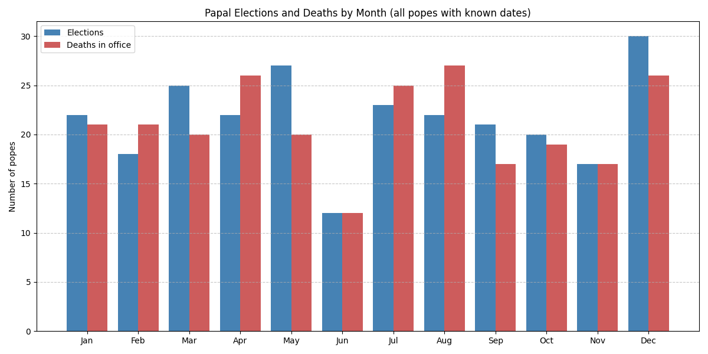
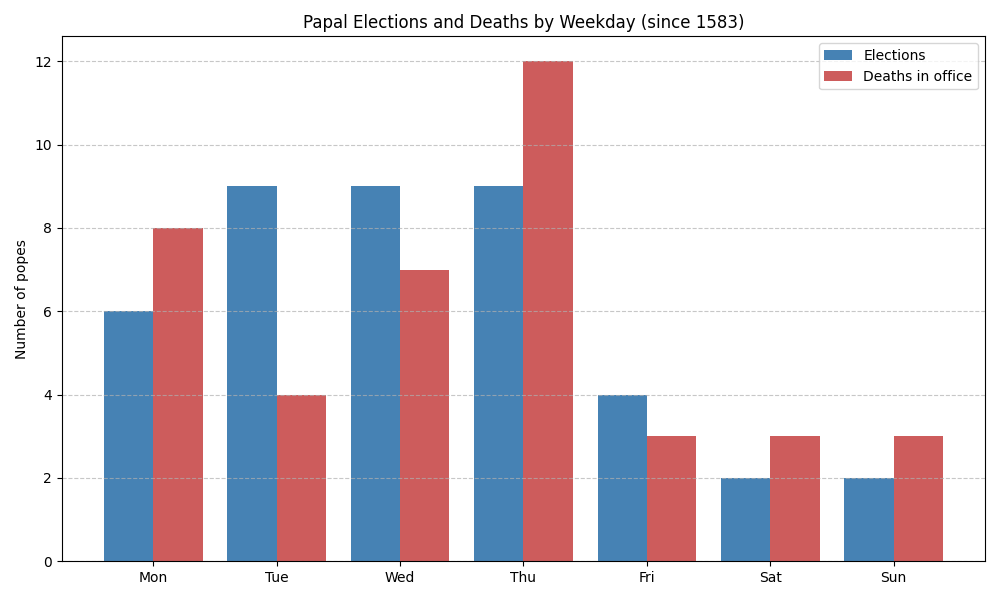

Note: The month statistics use every pope whose dates are known to the day: 259 elections and 251 deaths in office. Popes who resigned or were deposed are excluded from the death counts. Weekdays are only counted from 1583, after Rome adopted the Gregorian calendar. Exact birth dates are known for only 64 popes, almost all elected after 1400.

# Elections and Deaths by Month

| Month     | Elections | Deaths in office |
| --------- | --------- | ---------------- |
| January   | 22        | 21               |
| February  | 18        | 21               |
| March     | 25        | 20               |
| April     | 22        | 26               |
| May       | 27        | 20               |
| June      | 12        | 12               |
| July      | 23        | 25               |
| August    | 22        | 27               |
| September | 21        | 17               |
| October   | 20        | 19               |
| November  | 17        | 17               |
| December  | 30        | 26               |

**December** has the most papal elections (30). **June** is the quietest month for both elections and deaths: 12 of each, about half the monthly average of roughly 21. With twelve months to compare, one month this low can easily happen by chance, so it is probably a coincidence rather than a pattern.

Deaths peak in **August** (27), with July close behind (25).

# Elections and Deaths by Weekday (since 1583)

| Weekday   | Elections | Deaths in office |
| --------- | --------- | ---------------- |
| Monday    | 6         | 8                |
| Tuesday   | 9         | 4                |
| Wednesday | 9         | 7                |
| Thursday  | 9         | 12               |
| Friday    | 4         | 3                |
| Saturday  | 2         | 3                |
| Sunday    | 2         | 3                |

Out of 41 elections since 1583, 27 fell between Tuesday and Thursday. Only two popes were elected on a Sunday: **Urban VIII** (6 August 1623) and **Leo XII** (28 September 1823).

# Birthday Coincidences

- **Pius XII** was elected on **2 March 1939, his 63rd birthday**. He is the only pope in the dataset elected on his birthday.
- **Benedict XVI** was elected on 19 April 2005, three days after turning 78.
- **Innocent XIII** was elected on 8 May 1721, five days before his 66th birthday.
- **Marcellus II** died on 1 May 1555, five days before his 54th birthday and 22 days after his election.
- **Honorius II** (1130), **Clement IV** (1268), **Pius VII** (1823) and **Clement VIII** (1605) each died within a week after their birthday.

# Dying on the Anniversary of Election

- **Adrian II** was elected on 14 December 867 and died on 14 December 872, exactly five years later.
- His successor **John VIII** was elected on that same day, 14 December 872, and died on 16 December 882, two days after the tenth anniversary of his election.
- **Honorius IV** died on 3 April 1287, one day after the second anniversary of his election.
- **Soter** (174) and **Sergius II** (847) each died two days after an anniversary of their election.
