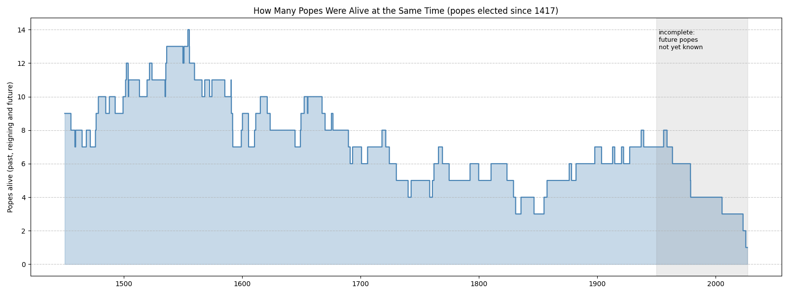
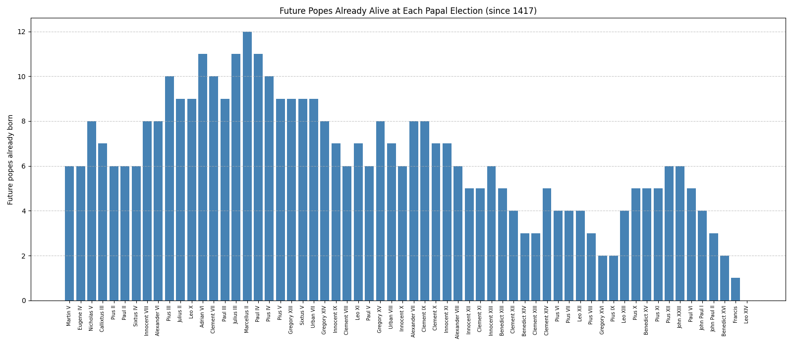

Note: This analysis covers popes elected from Martin V (1417) onward, the period for which birth years are documented. Exact birth days are unknown for Martin V, Eugene IV and Innocent VIII. Benedict XVI is counted as alive until his death on 31 December 2022, not until his resignation. Counts for recent decades are incomplete, because popes who have not been elected yet are not in the data.

# Most Popes Alive at the Same Time

**14 popes**, past, reigning and future, were alive at the same time between January 1554 and March 1555:

Julius III (reigning), Marcellus II, Paul IV, Pius IV, Pius V, Gregory XIII, Sixtus V, Urban VII, Gregory XIV, Innocent IX, Clement VIII, Leo XI, Paul V and Gregory XV.

This window opened when the future Gregory XV was born on 9 January 1554. It closed when Julius III died on 29 March 1555.

The low point came between about 1830 and 1854, when at times only **3** popes were alive at once.

# Future Popes Already Alive at Each Election

| Pope          | Elected | Future popes alive | Furthest future pope alive |
| ------------- | ------- | ------------------ | -------------------------- |
| Marcellus II  | 1555    | 12                 | Gregory XV (+12)           |
| Adrian VI     | 1522    | 11                 | Innocent IX (+12)          |
| Julius III    | 1550    | 11                 | Leo XI (+11)               |
| Paul IV       | 1555    | 11                 | Gregory XV (+11)           |
| Urban VII     | 1590    | 9                  | Clement X (+11)            |
| Pius III      | 1503    | 10                 | Gregory XIII (+11)         |
| Innocent VIII | 1484    | 8                  | Paul IV (+10)              |
| ...           |         |                    |                            |
| Pius XII      | 1939    | 6                  | Francis (+6)               |
| John XXIII    | 1958    | 6                  | Leo XIV (+6)               |
| Francis       | 2013    | 1                  | Leo XIV (+1)               |

When **Marcellus II** was elected in 1555, the next 12 popes were already alive. The last of them, Gregory XV, was elected 66 years later, in 1621.

When **John XXIII** was elected in 1958, every pope who has reigned since then was already alive, including Leo XIV, who was then two years old.

In the first half of the 19th century the pool was the smallest. When Gregory XVI (1831) and Pius IX (1846) were elected, only two future popes had been born.

# Former Popes Still Alive

Since 1417, only one pope has been elected while a former pope was still alive: **Francis** in 2013, while Benedict XVI was pope emeritus. They overlapped for almost ten years, until Benedict XVI's death on 31 December 2022.

# Most Pontificates Lived Through

| #   | Pope         | Pontificates lived through (including his own) | Born under    |
| --- | ------------ | ----------------------------------------------- | ------------- |
| 1   | Innocent IX  | 14                                              | Leo X         |
| 2   | Gregory XV   | 14                                              | Julius III    |
| 3   | Gregory XIII | 13                                              | Alexander VI  |
| 4   | Leo XI       | 13                                              | Paul III      |
| 5   | Paul V       | 13                                              | Julius III    |
| 6   | Clement X    | 13                                              | Sixtus V      |
| 7   | Paul IV      | 12                                              | Sixtus IV     |
| 8   | Urban VII    | 12                                              | Leo X         |
| 9   | Clement VIII | 12                                              | Paul III      |

Most of these men lived through the rapid turnover of the 16th century, when many pontificates lasted only months.
