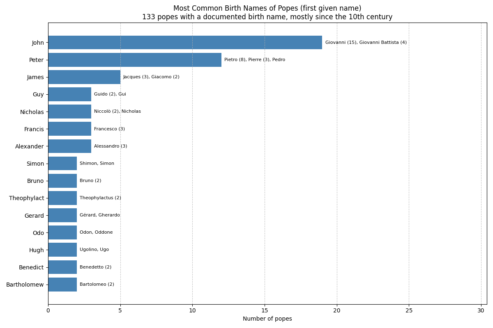
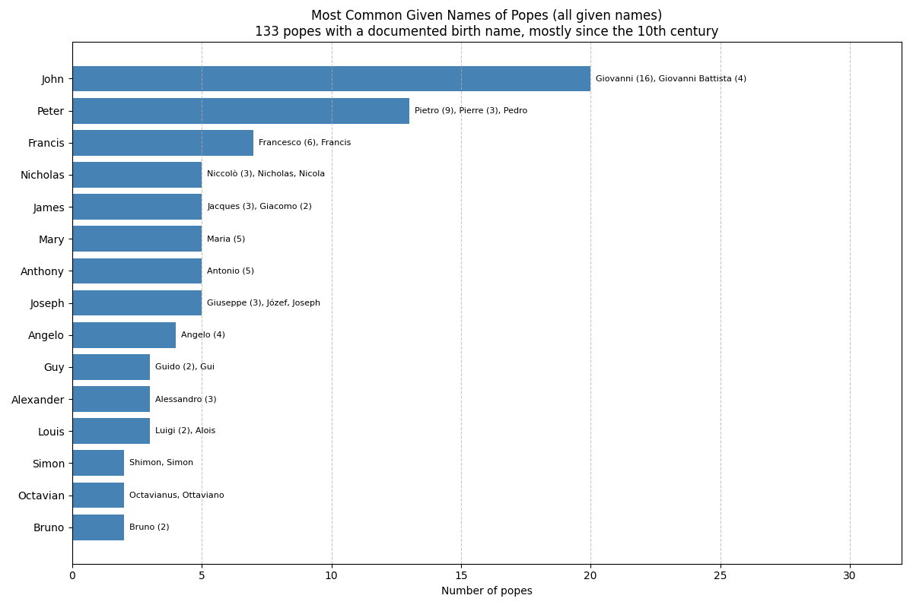

Note: Birth names are documented for 133 popes, almost all elected after 955. Earlier popes mostly kept their own names (see the last section). Names in different languages are merged into one common English form: Giovanni counts as John; Pietro, Pierre and Pedro count as Peter; Jacques and Giacomo count as James. The original forms are listed alongside each name. The mapping for every pope is in [birth_names.csv](birth_names.csv).

# Most Common Birth Names (first given name)

| #   | Name     | Popes | Forms used                            | Popes |
| --- | -------- | ----- | ------------------------------------- | ----- |
| 1   | John     | 19    | Giovanni (15), Giovanni Battista (4)  | John XVII, John XVIII, Sylvester III, Gregory VI, Gelasius II, Nicholas III, Innocent VIII, Leo X, Julius III, Paul IV, Pius IV, Urban VII, Innocent IX, Innocent X, Clement XI, Clement XIV, Pius VI, Pius IX, Paul VI |
| 2   | Peter    | 12    | Pietro (8), Pierre (3), Pedro         | John XIV, Sergius IV, Eugene III, Innocent V, John XXI, Celestine V, Clement VI, Gregory XI, Boniface IX, Paul II, Alexander VIII, Benedict XIII |
| 3   | James    | 5     | Jacques (3), Giacomo (2)              | Urban IV, Honorius IV, John XXII, Benedict XII, Benedict XV |
| 4   | Guy      | 3     | Guido (2), Gui                        | Callixtus II, Celestine II, Clement IV |
| 5   | Nicholas | 3     | Niccolò (2), Nicholas                 | Adrian IV, Benedict XI, Gregory XIV |
| 6   | Francis  | 3     | Francesco (3)                         | Sixtus IV, Pius III, Pius VIII |
| 7   | Alexander | 3    | Alessandro (3)                        | Paul III, Leo XI, Gregory XV |
| 8   | Simon    | 2     | Shimon, Simon                         | Peter, Martin IV |
| 9   | Bruno    | 2     | Bruno (2)                             | Gregory V, Leo IX |
| 10  | Theophylact | 2  | Theophylactus (2)                     | Benedict VIII, Benedict IX |
| 11  | Gerard   | 2     | Gérard, Gherardo                      | Nicholas II, Lucius II |
| 12  | Odo      | 2     | Odon, Oddone                          | Urban II, Martin V |
| 13  | Hugh     | 2     | Ugolino, Ugo                          | Gregory IX, Gregory XIII |
| 14  | Benedict | 2     | Benedetto (2)                         | Boniface VIII, Innocent XI |
| 15  | Bartholomew | 2  | Bartolomeo (2)                        | Urban VI, Gregory XVI |

The 133 popes had 79 different first names.

**John** leads, as it does among papal names. One pope in seven with a known birth name was born Giovanni, and those 19 men chose 12 different papal names. Only two of them, John XVII and John XVIII, kept the name John. Meanwhile, the popes named John in the second millennium were mostly born with other names: Romanus (John XIX), Pedro (John XXI), Jacques (John XXII) and Angelo (John XXIII).

**Peter** is second, with 12 popes, and none of them took Peter as their papal name. No pope has used the name of the apostle. Peter himself was born **Simon** (Shimon).

**James** owes its place to the Avignon popes: Urban IV, John XXII and Benedict XII were all born Jacques.

# Counting Every Given Name

Many modern popes had several given names; Leo XII had six: Annibale Francesco Clemente Melchiore Girolamo Nicola. Counting all of them:

| #   | Name      | Popes | Forms used                           |
| --- | --------- | ----- | ------------------------------------ |
| 1   | John      | 20    | Giovanni (16), Giovanni Battista (4) |
| 2   | Peter     | 13    | Pietro (9), Pierre (3), Pedro        |
| 3   | Francis   | 7     | Francesco (6), Francis               |
| 4   | Nicholas  | 5     | Niccolò (3), Nicholas, Nicola        |
| 5   | James     | 5     | Jacques (3), Giacomo (2)             |
| 6   | Mary      | 5     | Maria (5)                            |
| 7   | Anthony   | 5     | Antonio (5)                          |
| 8   | Joseph    | 5     | Giuseppe (3), Józef, Joseph          |
| 9   | Angelo    | 4     | Angelo (4)                           |
| 10  | Guy       | 3     | Guido (2), Gui                       |
| 11  | Alexander | 3     | Alessandro (3)                       |
| 12  | Louis     | 3     | Luigi (2), Alois                     |

- **Joseph** is a modern name: all five popes who had it were elected after 1900: Pius X, Pius XII, John XXIII, John Paul II (Karol Józef) and Benedict XVI (Joseph Alois).
- **Mary (Maria)** appears as a male middle name for five popes, from Julius III (1550) to Paul VI (1963).
- **Francis** is the given name of seven popes. The most recent is Leo XIV, born Robert Francis Prevost, who succeeded Pope Francis.

# Popes Who Kept Their Birth Name

Among popes with a documented birth name, four kept it as their papal name:

- John XVII (Giovanni Sicco, 1003)
- John XVIII (Giovanni Fasano, 1003)
- Adrian VI (Adriaan Floriszoon Boeyens, 1522)
- Marcellus II (Marcello Cervini, 1555), the last pope to do so.

# Including the First Millennium

Before Gregory V (996), taking a new papal name was the exception: John II (533), John III, John XII and John XIV are the only earlier popes recorded as changing their names. If the other 132 popes before Gregory V are assumed to have kept their birth names, the ranking over 265 popes becomes:

| #   | Name      | Popes |
| --- | --------- | ----- |
| 1   | John      | 30    |
| 2   | Peter     | 12    |
| 3   | Benedict  | 9     |
| 4   | Stephen   | 9     |
| 5   | Leo       | 8     |
| 6   | Boniface  | 6     |
| 7   | Gregory   | 5     |
| 8   | James     | 5     |
| 9   | Nicholas  | 4     |
| 10  | Adrian    | 4     |
| 11  | Alexander | 4     |
| 12  | Felix     | 4     |

This is an estimate: for most of these early popes, no birth name is recorded at all.
