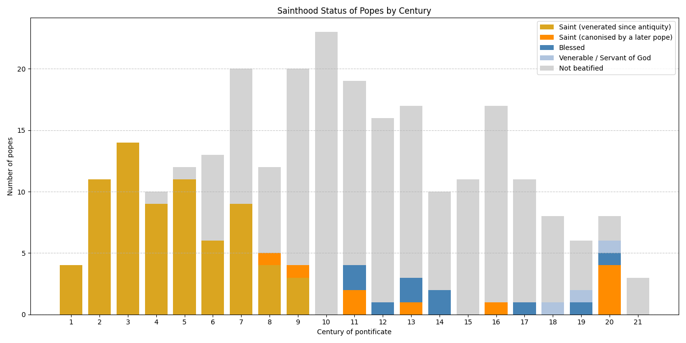
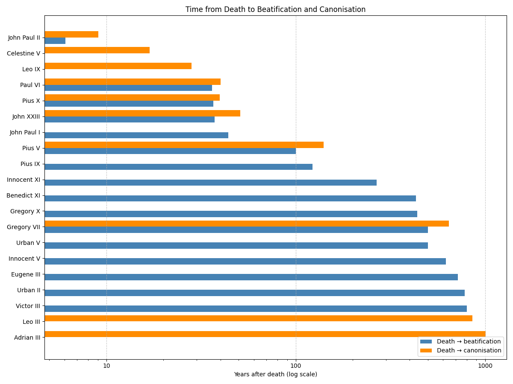

Note: Sainthood data follows Wikipedia's [List of canonised popes](https://en.wikipedia.org/wiki/List_of_canonised_popes) (checked October 2026), with beatification and canonisation dates taken from each pope's article. Benedict IX, who reigned three times, is counted once, so the total is 265 popes. Time from death is measured from the actual death date, not the end of the pontificate, for Celestine V, who resigned in 1294 and died in 1296.

# Overview

| Status                             | Popes |
| ---------------------------------- | ----- |
| Saint (venerated since antiquity)  | 71    |
| Saint (canonised by a later pope)  | 10    |
| Blessed                            | 10    |
| Venerable                          | 1     |
| Servant of God                     | 2     |
| Not beatified                      | 171   |

**The first 35 popes are all saints**, from Peter to Julius I. The run ends with Liberius (352–366), the first pope not venerated as a saint in the Latin Church. Eastern Christianity does venerate him as a saint.

Most of the 81 papal saints were never canonised in a formal process. They were venerated as saints from antiquity, before the Church had canonisation procedures. The last pope to become a saint this way is Nicholas I (858–867).

Only 10 popes were declared saints by a later pope: Leo III, Adrian III, Leo IX, Gregory VII, Celestine V, Pius V, Pius X, John XXIII, Paul VI and John Paul II. Leo III and Adrian III were declared saints by "equipollent" canonisation: a later pope confirmed a cult that already existed, without a full canonisation process.

# Sainthood by Century

- From the 1st to the 3rd century, every pope is a saint: 29 of 29.
- **10th century:** not one of its 23 popes has been beatified. This was the *saeculum obscurum*, the era of the Cadaver Synod and of popes who were deposed and murdered.
- **15th century:** none of its 11 popes, Renaissance popes among them, is a saint, a Blessed, or even a candidate.
- **20th century:** the most saintly century since the early Church. Of its 8 popes, 4 are saints (Pius X, John XXIII, Paul VI, John Paul II), 1 is Blessed (John Paul I) and 1 is Venerable (Pius XII). Only Benedict XV and Pius XI have no cause.

# Time from Death to Beatification and Canonisation

| #   | Pope         | Died | Beatified            | Canonised             | Death → beatification | Death → canonisation |
| --- | ------------ | ---- | -------------------- | --------------------- | --------------------- | -------------------- |
| 1   | John Paul II | 2005 | 2011 by Benedict XVI | 2014 by Francis       | 6.1 years             | 9.1 years            |
| 2   | Celestine V  | 1296 | -                    | 1313 by Clement V     | -                     | 17.0 years           |
| 3   | Leo IX       | 1054 | -                    | 1082 by Gregory VII   | -                     | 28.2 years           |
| 4   | Paul VI      | 1978 | 2014 by Francis      | 2018 by Francis       | 36.2 years            | 40.2 years           |
| 5   | Pius X       | 1914 | 1951 by Pius XII     | 1954 by Pius XII      | 36.8 years            | 39.8 years           |
| 6   | John XXIII   | 1963 | 2000 by John Paul II | 2014 by Francis       | 37.3 years            | 50.9 years           |
| 7   | John Paul I  | 1978 | 2022 by Francis      | -                     | 43.9 years            | -                    |
| 8   | Pius V       | 1572 | 1672 by Clement X    | 1712 by Clement XI    | 100.0 years           | 140.1 years          |
| 9   | Pius IX      | 1878 | 2000 by John Paul II | -                     | 122.6 years           | -                    |
| 10  | Innocent XI  | 1689 | 1956 by Pius XII     | -                     | 267.1 years           | -                    |
| 11  | Benedict XI  | 1304 | 1736 by Clement XII  | -                     | 431.8 years           | -                    |
| 12  | Gregory X    | 1276 | 1713 by Clement XI   | -                     | 437.5 years           | -                    |
| 13  | Gregory VII  | 1085 | 1584 by Gregory XIII | 1728 by Benedict XIII | 499.0 years           | 643.0 years          |
| 14  | Urban V      | 1370 | 1870 by Pius IX      | -                     | 499.2 years           | -                    |
| 15  | Innocent V   | 1276 | 1898 by Leo XIII     | -                     | 621.7 years           | -                    |
| 16  | Eugene III   | 1153 | 1872 by Pius IX      | -                     | 719.5 years           | -                    |
| 17  | Urban II     | 1099 | 1881 by Leo XIII     | -                     | 781.9 years           | -                    |
| 18  | Victor III   | 1087 | 1887 by Leo XIII     | -                     | 799.8 years           | -                    |
| 19  | Leo III      | 816  | -                    | 1673 by Clement X     | -                     | ~857 years           |
| 20  | Adrian III   | 885  | -                    | 1891 by Leo XIII      | -                     | 1005.9 years         |

**John Paul II** is by far the fastest. Benedict XVI waived the usual five-year waiting period, and John Paul II was beatified 6 years and canonised 9 years after his death.

**Celestine V** was canonised just 17 years after his death, by Clement V. His canonisation was pushed by the French king Philip IV as part of his campaign against Celestine's successor and rival, Boniface VIII.

**Adrian III** waited more than a thousand years: he died in 885, and Leo XIII confirmed his cult in 1891.

Gregory VII spent 144 years as a Blessed before he was canonised, the longest gap between the two steps. For Pius X and John Paul II, the gap was only 3 years.

# Beatifications and Canonisations of Popes per Century

| Century | Beatifications | Canonisations |
| ------- | -------------- | ------------- |
| 11th    | 0              | 1             |
| 12th    | 0              | 0             |
| 13th    | 0              | 0             |
| 14th    | 0              | 1             |
| 15th    | 0              | 0             |
| 16th    | 1              | 0             |
| 17th    | 1              | 1             |
| 18th    | 2              | 2             |
| 19th    | 5              | 1             |
| 20th    | 2              | 1             |
| 21st    | 5              | 3             |

Of the 26 papal beatifications and canonisations by a later pope, **8 happened in the 21st century** (here counted as 2000 onward):

- Beatified: John XXIII and Pius IX (2000), John Paul II (2011), Paul VI (2014), John Paul I (2022).
- Canonised: John XXIII and John Paul II (2014), Paul VI (2018).

Two pairs were raised on the same day:

- John XXIII and Pius IX were beatified together on 3 September 2000.
- John XXIII and John Paul II were canonised together on 27 April 2014, the first time two popes were canonised at once.

# Popes Who Beatified or Canonised Other Popes

| Pope          | Beatified                      | Canonised                         |
| ------------- | ------------------------------ | --------------------------------- |
| Francis       | Paul VI, John Paul I           | John XXIII, John Paul II, Paul VI |
| Leo XIII      | Urban II, Victor III, Innocent V | Adrian III                      |
| Pius XII      | Pius X, Innocent XI            | Pius X                            |
| Clement X     | Pius V                         | Leo III                           |
| Clement XI    | Gregory X                      | Pius V                            |
| John Paul II  | John XXIII, Pius IX            | -                                 |
| Pius IX       | Eugene III, Urban V            | -                                 |
| Benedict XVI  | John Paul II                   | -                                 |
| Benedict XIII | -                              | Gregory VII                       |
| Clement XII   | Benedict XI                    | -                                 |
| Clement V     | -                              | Celestine V                       |
| Gregory XIII  | Gregory VII                    | -                                 |
| Gregory VII   | -                              | Leo IX                            |

**Francis** raised more of his predecessors to the altars than any other pope: four popes, through five beatifications and canonisations. **Leo XIII** is second, with four popes from the 9th to the 13th centuries.

Some of these popes were later raised in turn:

- John Paul II beatified John XXIII and was then canonised alongside him.
- Pius IX beatified two medieval popes and was himself beatified in 2000.
- Gregory VII canonised Leo IX, the pope he had served as a young cleric. He was beatified and canonised himself centuries later.
- Pius XII both beatified and canonised Pius X. Pius XII himself is still only Venerable.

# Causes in Progress

| Pope          | Status         | Declared   |
| ------------- | -------------- | ---------- |
| Pius XII      | Venerable      | 2009-12-19 |
| Pius VII      | Servant of God | 2007-08-15 |
| Benedict XIII | Servant of God | 2017-02-24 |

As of October 2026, Pius XII's cause still awaits an approved miracle. No cause has been opened for Benedict XVI (died 2022) or Francis (died 2025). The usual five-year waiting period after death would allow Benedict XVI's cause to open from the end of 2027.
